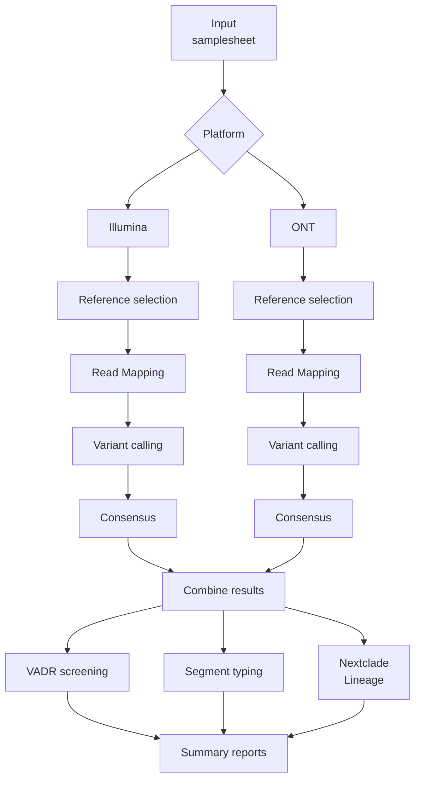

# nf-fluab

**nf-fluab** is a Nextflow pipeline for influenza A and B sequencing analysis. It takes sequencing reads as input and performs reference selection, read mapping, variant calling, consensus sequence generation, typing, lineage assignment, VADR annotation, and report generation.

Version 2.x assumes that reads have already undergone quality control and preprocessing; it does not perform the initial read quality control step. In our organization, this is performed using [`nf-qcflow`](https://github.com/xiaoli-dong/qcflow), and the resulting quality-controlled reads are passed to `nf-fluab` for influenza analysis. Version 1.x supports initial read quality control as part of the pipeline.

## Workflow overview

The pipeline automatically detects the sequencing platform from the input samplesheet and directs reads to the appropriate analysis branch. A sample can have both Illumina and Oxford Nanopore Technologies (ONT) data, which are processed separately through their respective analysis branches within the same pipeline run. Samples with data from either platform can also be included in the same analysis.



### Analysis steps

1. **Reference selection** – Mash Screen compares reads against the local influenza reference database and selects suitable references for downstream analysis.
2. **Read mapping and coverage** – Illumina reads are mapped using minibwa; ONT reads are mapped using minimap2. Alignment and coverage statistics are generated.
3. **Variant calling and filtering** – Illumina variants are called using the configured FreeBayes. ONT variants are called using Clair3. Variants are normalized and filtered before consensus generation.
4. **Consensus generation** – A consensus sequence is generated for each platform of the sample and influenza segment.
5. **Sequence screening and typing** – Consensus sequences are annotated with VADR and typed against the local influenza typing database.
6. **Lineage assignment** – Nextclade assigns influenza lineage using the configured influenza datasets.
7. **Reporting** – Consensus sequences of platform-specific reports for each sample are combined, and summary reports are generated.

## Requirements

- Nextflow **25.10.4 or later**
- The pipeline includes configuration profiles for the supported execution environments. Select the profile appropriate for your system. The supported execution environments are listed below:
  - Docker, Singularity, Apptainer, Conda or Mamba, Podman, Shifter, or Charliecloud. In our organization, we are using singularity
- Access to the required reference data and databases described in the reference database section 

## Input samplesheet

Provide a comma-separated CSV file with the following columns:

| Column | Description |
|---|---|
| `sample` | Sample identifier |
| `fastq_1` | Illumina read 1 FASTQ file |
| `fastq_2` | Illumina read 2 FASTQ file; use `NA` for single-end Illumina data |
| `fastq_long` | ONT FASTQ file |

Use `NA` for columns that do not apply to a sample. The platform is determined from the populated read columns; there is no `--platform` command-line option.

Example:

```csv
sample,fastq_1,fastq_2,fastq_long
sample_illumina,reads_R1.fastq.gz,reads_R2.fastq.gz,NA
sample_illumina_se,reads.fastq.gz,NA,NA
sample_nanopore,NA,NA,reads.fastq.gz
```

Each row represents one sample/library input. Use unique sample identifiers for distinct inputs.

## Reference databases

The pipeline requires the access to the influenza reference fasta sequence database and it msh file generated with mash sketch.

### Influenza reference database

Set `--fluab_reference_db` to the reference database directory. The directory must contain:

```text
fluab_reference_db/
├── reference.fasta
└── reference.msh
```

- `reference.fasta` contains the reference sequences used to generate reference.msh.
- `reference.msh` is the Mash sketch database used for reference selection.

The reference database is built separately. See the repository's reference database building documentation for the database preparation workflow.

## Quick start

### 1. Check the pipeline options

```bash
nextflow run xiaoli-dong/nf-fluab -r ffbc2bd --help
```

### 2. Run the pipeline

```bash
nextflow run xiaoli-dong/nf-fluab \
    -r ffbc2bd \
    --input samplesheet.csv \
    --outdir results \
    --fluab_reference_db /path/to/fluab_reference_db \
    -profile singularity \
    -resume
```

Replace `/path/to/fluab_reference_db` with the path to the prepared reference database. Change `-profile singularity` to the execution profile available on your system.

For a local clone or development checkout, run the pipeline from the repository directory:

```bash
nextflow run path_to/main.nf \
    --input samplesheet.csv \
    --outdir results \
    --fluab_reference_db /path/to/fluab_reference_db \
    -profile singularity \
    -resume
```

### Useful options

| Option | Description |
|---|---|
| `--input` | Input samplesheet CSV |
| `--outdir` | Output directory |
| `--fluab_reference_db` | Directory containing `reference.fasta` and `reference.msh` |
| `-profile` | Execution environment/configuration profile |
| `-resume` | Resume a previous run using cached process results |

Use `--help` to see the available pipeline parameters and their current defaults.

## Output structure

The pipeline publishes results in the output directory. Main result directories include:

```text
results/
├── consensus/        # Consensus FASTA sequences and stats
├── mapping/          # Alignment and coverage outputs
├── nextclade/        # Nextclade lineage results
├── pipeline_info/    # Nextflow execution reports and metadata
├── report/           # Consolidated analysis reports
├── seekref/          # Mash results and selected references
├── typing/           # Segment typing results
├── vadr/             # Segment VADR annotation results
└── variants/         # Variant-calling outputs
```

The exact files produced depend on the input data and the analysis branches executed. The `pipeline_info/` directory contains the Nextflow execution report, timeline, trace, and workflow DAG.

## Testing

The repository includes local test data under `tests/test_data/` and test configuration under `conf/`. See the test configuration and repository test definitions for the available test runs.

## Credits

- **nf-fluab** was written by **Xiaoli Dong**.
- The reference selection components was developed with reference to **Dr. Matthew Croxen's** influenza pipeline.
- Extensive support was provided by the **ProvLab Research Team** (kanti Pabbaraju, Kara Gill, Anita Wang) in Calgary for generating sequencing data, conducting pipeline testing and validation:
- **Dr. Tarah Lynch** and **Dr. Matthew Croxen** provided extensive technical input.

## Citations

The `nf-fluab` workflow was developed with reference to existing influenza sequencing workflows and uses the following bioinformatics tools:

- CFIA-NCFAD/nf-flu: https://github.com/CFIA-NCFAD/nf-flu
- INSaFLU: https://insaflu.insa.pt
- Di Tommaso, P., et al. (2017). Nextflow enables reproducible computational workflows. *Nature Biotechnology*, 35, 316–319. https://doi.org/10.1038/nbt.3820
- Li, H., & Durbin, R. (2009). Fast and accurate short read alignment with Burrows–Wheeler transform. *Bioinformatics*, 25(14), 1754–1760. https://doi.org/10.1093/bioinformatics/btp324
- Li, H. (2018). Minimap2: pairwise alignment for nucleotide sequences. *Bioinformatics*, 34(18), 3094–3100. https://doi.org/10.1093/bioinformatics/bty191
- Garrison, E., & Marth, G. (2012). Haplotype-based variant detection from short-read sequencing. https://arxiv.org/abs/1207.3907
- Zheng, Z., et al. (2022). Symphonizing pileup and full-alignment for deep learning-based long-read variant calling. *Nature Computational Science*, 2, 797–803. https://doi.org/10.1038/s43588-022-00387-x
- Aksamentov, I., et al. (2021). Nextclade: clade assignment, mutation calling and quality control for viral genomes. *Journal of Open Source Software*, 6(67), 3773. https://doi.org/10.21105/joss.03773
  
## License

This project is distributed under the MIT License. See [LICENSE](LICENSE).
