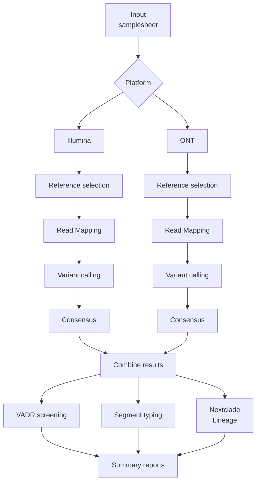

# nf-fluab

**nf-fluab** is a Nextflow pipeline for influenza A and B sequence analysis using Illumina and Oxford Nanopore Technologies (ONT) reads. It selects suitable reference sequences, maps reads, calls variants, generates consensus sequences, and performs segment typing and lineage assignment.

- **Pipeline version:** 2.1.0
- **Minimum Nextflow version:** 25.10.4

## Workflow overview

The workflow separates samples by sequencing platform and runs the appropriate analysis branch. Illumina and ONT samples can be included in the same samplesheet and processed in one pipeline run.



### Analysis steps

1. **Reference selection** – Mash Screen compares reads against the local influenza reference database and selects suitable references for downstream analysis.
2. **Read mapping and coverage** – Illumina reads are mapped using minibwa; ONT reads are mapped using minimap2. Alignment and coverage statistics are generated.
3. **Variant calling and filtering** – Illumina variants are called using the configured FreeBayes. ONT variants are called using Clair3. Variants are normalized and filtered before consensus generation.
4. **Consensus generation** – A consensus sequence is generated for each platform of the sample and influenza segment.
5. **Sequence screening and typing** – Consensus sequences are annotated with VADR and typed against the local influenza typing database.
6. **Lineage assignment** – Nextclade assigns influenza lineage using the configured influenza datasets.
7. **Reporting** – Consensus sequences of platform-specific reports for each sample are combined, and summary reports are generated.

## Requirements

- Nextflow **25.10.4 or later**
- One supported execution environment:
  - Docker
  - Singularity or Apptainer
  - Conda or Mamba
  - Podman, Shifter, or Charliecloud
- Access to the required reference data and databases described below

The pipeline includes configuration profiles for the supported execution environments. Select the profile appropriate for your system.

## Input samplesheet

Provide a comma-separated CSV file with the following columns:

| Column | Description |
|---|---|
| `sample` | Sample identifier |
| `fastq_1` | Illumina read 1 FASTQ file |
| `fastq_2` | Illumina read 2 FASTQ file; use `NA` for single-end Illumina data |
| `fastq_long` | ONT FASTQ file |

Use `NA` for columns that do not apply to a sample. The platform is determined from the populated read columns; there is no `--platform` command-line option.

Example:

```csv
sample,fastq_1,fastq_2,fastq_long
sample_illumina,reads_R1.fastq.gz,reads_R2.fastq.gz,NA
sample_illumina_se,reads.fastq.gz,NA,NA
sample_nanopore,NA,NA,reads.fastq.gz
```

Each row represents one sample/library input. Use unique sample identifiers for distinct inputs.

## Reference data and databases

The pipeline requires a local influenza A/B reference database and supporting resources.

### Influenza reference database

Set `--fluab_reference_db` to the reference database directory. The directory must contain:

```text
fluab_reference_db/
├── reference.fasta
└── reference.msh
```

- `reference.fasta` contains the reference sequences used to generate reference.msh.
- `reference.msh` is the Mash sketch database used for reference selection.

The reference database is built separately. See the repository's reference database building documentation for the database preparation workflow.

### Supporting resources

The pipeline also uses the following resources, configured through `nextflow.config` or an additional configuration file:

| Resource | Purpose |
|---|---|
| Influenza A/B primer FASTA (`flu_primers`) | Primer-related sequence processing |
| Influenza typing FASTA (`typing_db`) | Segment typing against the local typing database |
| Nextclade datasets CSV (`nextclade_datasets_csv`) | Dataset configuration for influenza lineage assignment |
| Clair3 model (`clair3_variant_model`) | ONT variant calling |

Check that the configured paths are accessible from the environment where the pipeline runs.

## Quick start

### 1. Check the pipeline options

```bash
nextflow run xiaoli-dong/nf-fluab -r 2.1.0 --help
```

### 2. Run the pipeline

```bash
nextflow run xiaoli-dong/nf-fluab \
    -r 2.1.0 \
    --input samplesheet.csv \
    --outdir results \
    --fluab_reference_db /path/to/fluab_reference_db \
    -profile docker \
    -resume
```

Replace `/path/to/fluab_reference_db` with the path to the prepared reference database. Change `-profile docker` to the execution profile available on your system.

For a local clone or development checkout, run the pipeline from the repository directory:

```bash
nextflow run . \
    --input samplesheet.csv \
    --outdir results \
    --fluab_reference_db /path/to/fluab_reference_db \
    -profile docker \
    -resume
```

### Useful options

| Option | Description |
|---|---|
| `--input` | Input samplesheet CSV |
| `--outdir` | Output directory |
| `--fluab_reference_db` | Directory containing `reference.fasta` and `reference.msh` |
| `-profile` | Execution environment/configuration profile |
| `-resume` | Resume a previous run using cached process results |

Use `--help` to see the available pipeline parameters and their current defaults.

## Output structure

The pipeline publishes results in the output directory. Main result directories include:

```text
results/
├── consensus/       # Consensus FASTA sequences
├── mapping/          # Alignment and coverage outputs
├── nextclade/        # Nextclade results
├── pipeline_info/    # Nextflow execution reports and metadata
├── report/           # Consolidated analysis reports
├── seekref/          # Mash results and selected references
├── typing/           # Segment typing results
├── vadr/             # VADR screening results
└── variants/         # Variant-calling outputs
```

The exact files produced depend on the input data and the analysis branches executed. The `pipeline_info/` directory contains the Nextflow execution report, timeline, trace, and workflow DAG.

## Testing

The repository includes local test data under `tests/test_data/` and test configuration under `conf/`. See the test configuration and repository test definitions for the available test runs.

## Credits

- **nf-fluab** was written by **Xiaoli Dong**.
- The Illumina component was primarily based on **Dr. Matthew Croxen's** influenza pipeline.
- Extensive support was provided by the **ProvLab Research Team** in Calgary for generating sequencing data and conducting pipeline testing:
  - Linda Lee
  - Johanna M. Thayer
  - Fitsum Getachew
  - Petya Kolva
  - Anita Wong
  - Kanti Pabbaraju
- **Dr. Tarah Lynch** and **Dr. Matthew Croxen** provided extensive technical input.

## License

This project is distributed under the MIT License. See [LICENSE](LICENSE).
